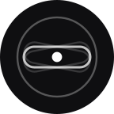

<p align="center">
  
</p>

<p align="center"><sub>V E H I C L E &nbsp; M O T I O N &nbsp; C U E S</sub></p>
<h1 align="center">Гиро</h1>

<p align="center">
  Точки по краям экрана повторяют движение в пути.<br>
  Взгляд и тело снова заодно — укачивание отступает.
</p>

<p align="center"><sub>Android 12+ · Material You</sub></p>

<br>

## Возможности

- **Два режима.** «Инерция», как в iOS: точки отвечают на разгон, торможение и повороты. «Гироскоп»: точки привязаны к миру вокруг.
- **Как на iPhone.** Один переключатель — и точки, движение и цвет как у Vehicle Motion Cues.
- **Monet.** Светлая, тёмная и динамическая тема; точки белые, чёрные или в цвет обоев.
- **Плитка в шторке.** Нажатие включает эффект, долгое нажатие открывает настройки.
- **Виброотклик Pixel.** Свой тактильный рисунок у кнопки, переключателей и каждого ползунка.
- **Поверх всего.** По желанию точки видны и над шторкой, и над клавиатурой.

## Как это работает

Акселерометр и датчик вращения переводятся в систему координат мира, из сигнала убираются
наклон телефона и дрожание. Мягкая пружина сдвигает поле точек вслед за
ускорением и плавно возвращает его обратно — глаза видят то же, что чувствует вестибулярный аппарат.

## Сборка

Нужны JDK 21 и Android SDK с platform 37. Их можно положить в `.toolchain/`
(не попадает в git) и подключить через `env.sh` — или указать свои `JAVA_HOME` и `ANDROID_HOME`.

```bash
source ./env.sh
./gradlew assembleDebug        # app/build/outputs/apk/debug/app-debug.apk
./gradlew testDebugUnitTest    # юнит-тесты
```

## Устройство

```
app/src/main/java/com/motioncues/app/
├── motion/     датчики → сигнал: оценка ускорения и вращения, пружина
├── overlay/    поле точек, окно поверх приложений, превью
├── haptics/    рецепты вибрации из примитивов
├── tile/       плитка быстрых настроек
├── settings/   настройки, темы, профиль «Как на iPhone»
└── ui/         общие экраны и ступенчатый ползунок
```

<br>

<p align="center"><sub><code>master</code> — стабильная ветка, каждая функция — отдельная <code>feature/NN-alias</code></sub></p>
